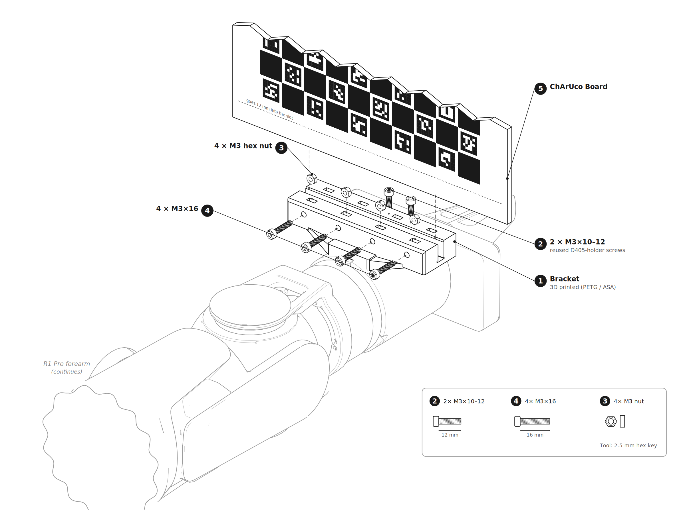

# R1 Pro ChArUco Mount

3D-printable mount that holds a `200 × 150 × 4mm` [ChArUco board](https://www.calitar.com/Charuco-Target/CALI100020TAR) on the end effector of a **Galaxea R1 Pro** for hand-eye calibration.

**No drilling needed.** The board slides into a slot and screws clamp it from behind.

